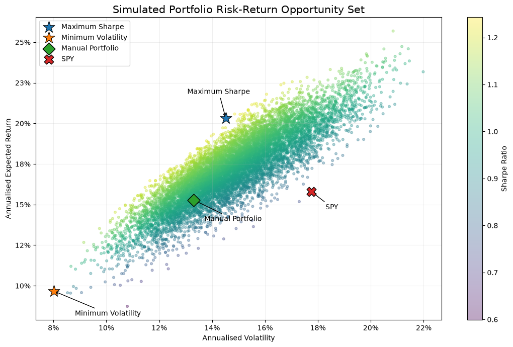
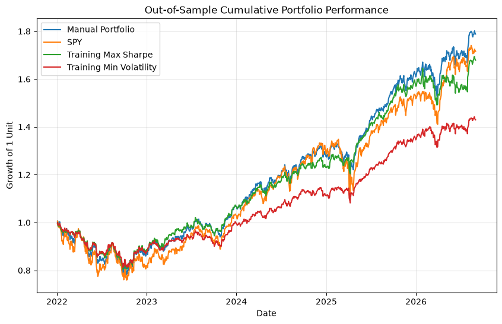

# Portfolio Risk & Optimisation

Can changing portfolio weights improve risk-adjusted performance? This notebook compares a manually selected seven-asset portfolio with SPY, explores 10,000 alternative allocations, and tests allocations selected on 2016–2021 data over a separate 2022–2026 period.

In the saved results, the training-selected maximum-Sharpe portfolio has a slightly higher test-period Sharpe ratio than the manual allocation (0.75 versus 0.73), but a lower CAGR (11.77% versus 13.29%).

## Portfolio and data

| Asset | Exposure | Manual weight |
| --- | --- | ---: |
| SPY | S&P 500 | 30% |
| MSFT | Microsoft | 12.5% |
| JPM | JPMorgan Chase | 10% |
| CAT | Caterpillar | 7.5% |
| VWO | Emerging-market equities | 10% |
| GLD | Gold | 10% |
| IEF | 7–10 year US Treasury bonds | 20% |

The notebook states that the manual weights were chosen before examining historical performance. The individual stocks add exposure to companies already held through SPY.

Adjusted closing prices come from Yahoo Finance through `yfinance`, with `auto_adjust=True`. The download requests 1 January 2016 to 1 September 2026; saved daily returns cover 5 January 2016 to 31 August 2026. The risk-free proxy is the [FRED DTB3 series](https://fred.stlouisfed.org/series/DTB3), the 3-month US Treasury bill discount rate.

## Method

- Calculate daily percentage returns, CAGR, annualised volatility, Sharpe ratio and maximum drawdown; inspect asset correlations and covariances.
- Apply constant weights to each day's asset returns. This implies daily rebalancing, rather than buying once and allowing weights to drift.
- Generate 10,000 long-only allocations by normalising independent uniform random draws, using seed `100`. Rank them by Sharpe ratio and volatility, with historical arithmetic mean returns and covariance annualised using 252 trading days.
- Evaluate the full-period selections on the same data, then repeat selection using only **5 January 2016–31 December 2021** and evaluate those weights on **3 January 2022–31 August 2026**.

“Maximum Sharpe” and “minimum volatility” refer to the best allocations in the random sample, not exact mathematical optima. The plotted opportunity set is not a solved efficient frontier.

Historical performance Sharpe ratios use mean daily excess returns, annualised by 252, divided by annualised return volatility. The notebook converts DTB3 to a daily rate with `(1 + rate) ** (1 / 252) - 1` and aligns it to return dates. Portfolio selection instead subtracts the period's average annual DTB3 rate from annualised mean returns, so selection and evaluation use slightly different risk-free conventions.

## Results

These figures are rounded from the notebook's saved comparison tables, which calculate CAGR using 365.25 calendar days per year. They have not been independently reproduced from a fresh data download.

### Full period: 2016–August 2026

The two simulated allocations below were selected and evaluated on the full period; their results are **in-sample**.

| Portfolio | CAGR | Annualised volatility | Sharpe ratio | Maximum drawdown |
| --- | ---: | ---: | ---: | ---: |
| Manual | 15.44% | 13.31% | 0.98 | −23.28% |
| SPY | 15.23% | 17.76% | 0.76 | −33.72% |
| Maximum Sharpe | 21.18% | 14.52% | 1.25 | −20.04% |
| Minimum volatility | 9.77% | 8.02% | 0.93 | −19.10% |

The manual portfolio had a similar CAGR to SPY with lower volatility and a smaller drawdown. The maximum-Sharpe result benefits from selecting weights using the same observations on which performance is measured.



### Test period: January 2022–August 2026

The simulated allocations here were selected using the training period only, then applied without re-estimating weights during the test period.

| Portfolio | CAGR | Annualised volatility | Sharpe ratio | Maximum drawdown |
| --- | ---: | ---: | ---: | ---: |
| Manual | 13.29% | 13.03% | 0.73 | −22.18% |
| SPY | 12.30% | 17.43% | 0.53 | −24.50% |
| Training maximum Sharpe | 11.77% | 10.50% | 0.75 | −19.63% |
| Training minimum volatility | 7.98% | 8.88% | 0.47 | −18.76% |

The training maximum-Sharpe allocation put 39.35% in IEF and 20.38% in GLD. It achieved lower test-period volatility and drawdown than the manual allocation, alongside lower returns. Its small Sharpe advantage is descriptive; the notebook does not test statistical significance. The manual allocation had the highest test-period CAGR of the four portfolios.



## Limitations and calculation notes

- Historical mean returns and covariances are sensitive to the sample period and may change. A single train/test split does not establish reliable future performance.
- The asset universe was chosen with current knowledge, creating potential selection and survivorship bias. The time split does not remove that bias or make the manual allocation a prospective investment record.
- The random search is approximate and does not sample the weight simplex uniformly. It explores only these seven assets, with no short positions or leverage.
- Daily rebalancing excludes transaction costs, bid–ask spreads and taxes. SPY is an equity benchmark for a portfolio that also holds bonds and gold, so their risk exposures differ.
- DTB3 is a discount yield, which the notebook treats as an effective annual rate for daily conversion. Missing rates are forward-filled before date alignment; remaining unmatched return dates are omitted from the excess-return mean, while volatility uses the return series.
- Data is downloaded live, so rerunning may produce different results or require adjustments if source formats change. Package versions are pinned in `requirements.txt`.

## Run

Use Python 3 with access to Yahoo Finance and FRED. From the repository directory:

```bash
python3 -m venv .venv
source .venv/bin/activate
python -m pip install -r requirements.txt
jupyter notebook portfolio_analysis.ipynb
```

On Windows, activate the environment with `.venv\Scripts\activate` instead. Run the notebook cells in order from a fresh kernel. The notebook contains the calculations and saved tables, and exports its charts to `figures/`.
